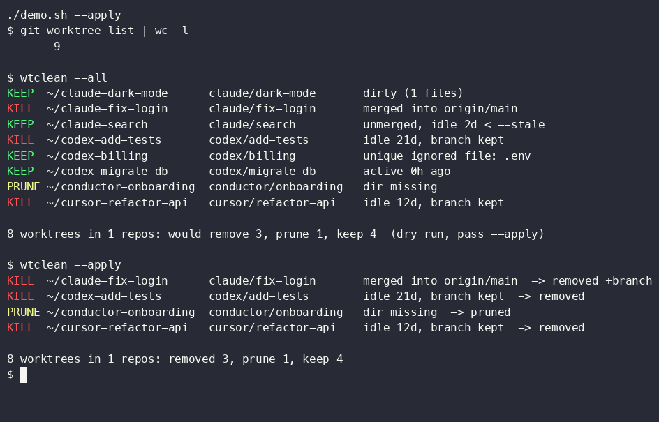

# wtclean

Coding agents (Claude Code, Codex, Cursor, Conductor...) each get their own git worktree. Nobody cleans them up. A few weeks in you have 150 worktrees per repo and gigabytes of stale `node_modules`.

`wtclean` finds the dead ones and removes them without losing work. One Python file, no dependencies.



## Install

```bash
curl -fsSL https://raw.githubusercontent.com/Ar9av/wtclean/main/wtclean -o ~/.local/bin/wtclean
chmod +x ~/.local/bin/wtclean
```

Needs Python 3.9+ and git. macOS and Linux.

## Use

```bash
wtclean                         # dry run for the repo you're in
wtclean --scan ~/code           # dry run for every repo under ~/code
wtclean --scan ~/code --apply   # remove the KILL rows
```

Try it on a throwaway repo first: `./demo.sh` builds one full of fake agent worktrees and runs wtclean on it.

## What gets removed

| Row   | When |
|-------|------|
| KILL  | clean, and either merged / remote branch deleted (idle > 24h) or unmerged and idle > 7 days |
| PRUNE | directory already deleted, git still lists it |
| KEEP  | anything below |

A worktree is always kept if it:

- has uncommitted or untracked changes
- is locked (`git worktree lock`)
- has a process running inside it (dev server, shell, agent)
- was touched within `--idle` hours, or is unmerged and younger than `--stale` days
- holds an ignored `.env*` file the main checkout doesn't have
- is a detached HEAD with commits not on any remote

## Why it's safe

- Dry run unless you pass `--apply`.
- Removal is `git worktree remove` without `--force`, so git itself refuses dirty trees. Never `rm -rf`.
- Branches are deleted only with `git branch -d`, which refuses unmerged work. Unmerged branches stay, so removing an idle worktree loses no commits; `git worktree add <path> <branch>` brings it back.
- Ignored files (`node_modules`, build output) go with the worktree. That's the disk you get back.

## Options

| Flag | Default | |
|------|---------|--|
| `--scan DIR` | | find repos under DIR (depth 3) |
| `--apply` | off | actually remove |
| `--idle H` | 24 | hours untouched before merged/gone worktrees count as dead |
| `--stale D` | 7 | days untouched before unmerged worktrees count as dead |
| `--fetch` | off | `git fetch --prune` first so merged/gone is current |
| `--json` | off | machine-readable output |
| `--all` | off | also print KEEP rows |

## Use it from an agent

Paste into `AGENTS.md` / `CLAUDE.md`:

```
Worktrees: lock the worktree you work in with `git worktree lock --reason "<task>" <path>`
and unlock it when done. Check for leftovers with `wtclean --json`. Only run
`wtclean --apply` when the user asks.
```

`--json` returns one object per worktree: `path`, `branch`, `action` (`kill` / `prune` / `keep`), `reason`, `idle_h`.

## Test

```bash
./test.sh
```

## License

MIT
